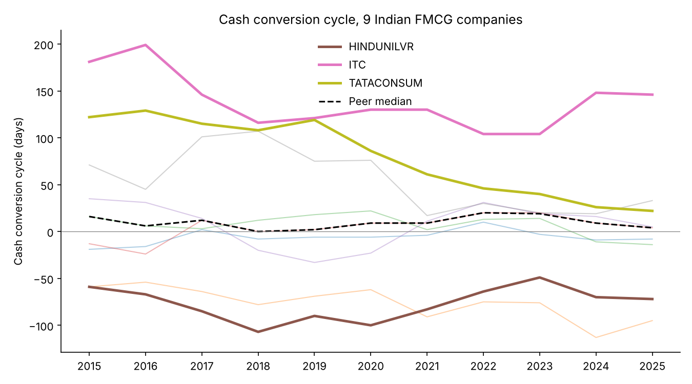
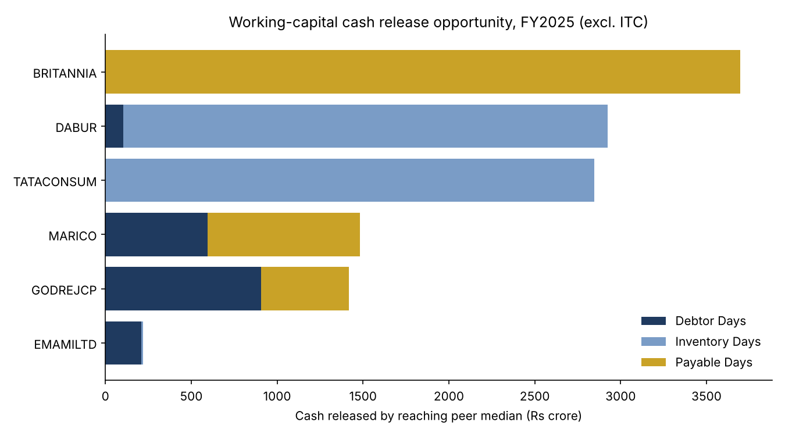

# Working Capital & Liquidity Benchmark: Indian FMCG

A treasury-style analysis of how efficiently 9 listed Indian FMCG companies turn operations into cash, FY2015–FY2025, and how much cash each could release by closing the gap to its peers. Each gap is mapped to the cash-management or trade-finance product a transaction bank would offer.

**Companies:** Hindustan Unilever, ITC, Britannia, Dabur, Marico, Godrej Consumer, Tata Consumer, Colgate-Palmolive (India), Emami.

## Key findings (FY2025)

1. **~Rs 12,600 crore could be released** across 6 companies (excluding ITC) by matching the peer median on receivable, inventory and payable days.
2. **Inventory is the biggest lever.** Tata Consumer (152 days) and Dabur (175 days) each hold roughly Rs 2,800 crore more stock than a peer-median company would. Fit: inventory and distributor finance.
3. **Payables lever: Britannia pays suppliers in 55 days vs a peer median of 133.** Moving towards the median would release up to Rs 3,700 crore. Fit: supply chain finance, which lets Britannia pay later while its suppliers still get paid early by the bank.
4. **Receivables lever: Godrej Consumer and Marico collect in 43–46 days vs a median of 23,** tying up Rs 600–900 crore each. Fit: collections tools, virtual accounts and receivables finance.
5. **HUL and Colgate run negative cash cycles (-72 and -95 days).** Suppliers effectively fund their operations; HUL's cycle is worth about Rs 12,100 crore of supplier-funded working capital.
6. **Tata Consumer cut its cycle from 122 to 22 days over ten years,** worth about Rs 4,800 crore at FY2025 sales: the strongest improvement in the group.
7. **Supply chain finance scenario:** a 15-day payable extension across all 9 companies releases about **Rs 9,000 crore**. The 15 days is an input you can change in the Excel model.




## Method

| Step | What | How |
|---|---|---|
| 1 | Data | Debtor, inventory and payable days and sales, FY2015–FY2025, from Screener.in ratio tables (consolidated; Britannia and Colgate standalone) |
| 2 | Validation | Checks that CCC = debtor days + inventory days − payable days for all 99 company-years (max rounding gap: 1 day) |
| 3 | Cash tied up | CCC × one day of sales (sales ÷ 365) |
| 4 | Release to median | For each lever: days worse than the peer median × one day of sales; zero if already better |
| 5 | Product mapping | Largest lever → receivables finance / inventory finance / supply chain finance |
| 6 | Scenario | Extra payable days from supply chain finance × one day of sales |

## Limitations

- **Sales base:** days are converted to rupees using sales. Inventory and payables are strictly driven by cost of goods sold, so those rupee figures are upper-bound estimates.
- **ITC excluded from the headline:** its leaf tobacco is aged for years by design, so the FMCG peer median is not a fair target. Including it would add about Rs 33,600 crore that is not realistic.
- **Medians are not targets for everyone.** Britannia already runs a negative cycle; a longer payable period is an option to weigh against supplier relationships, not a must.
- Annual year-end figures can be distorted by seasonality and one-off events.

## Files

```
data/raw_fmcg_working_capital.csv      source data (company x metric x year)
analysis.py                            validation, benchmarking, scenario, charts
build_excel.py                         builds the Excel model with live formulas
outputs/FMCG_Working_Capital_Model.xlsx  Inputs, Model, SCF Scenario, CCC Trend, Chart sheets
outputs/*.csv, *.png                   results tables and charts
```

Run: `pip install pandas matplotlib openpyxl`, then `python analysis.py && python build_excel.py`.

## Glossary

- **Debtor days:** how long customers take to pay.
- **Inventory days:** how long stock sits before it is sold.
- **Payable days:** how long the company takes to pay suppliers.
- **Cash conversion cycle (CCC):** debtor days + inventory days − payable days. Lower means less cash locked in operations; negative means suppliers fund the business.
